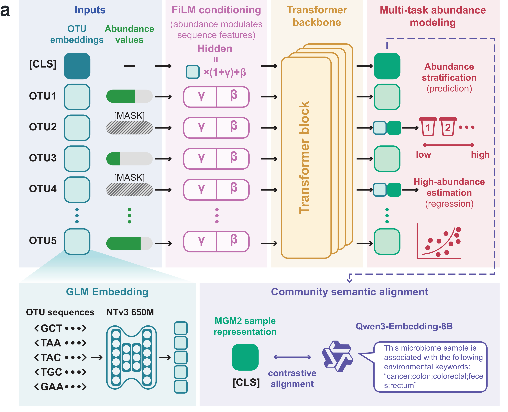
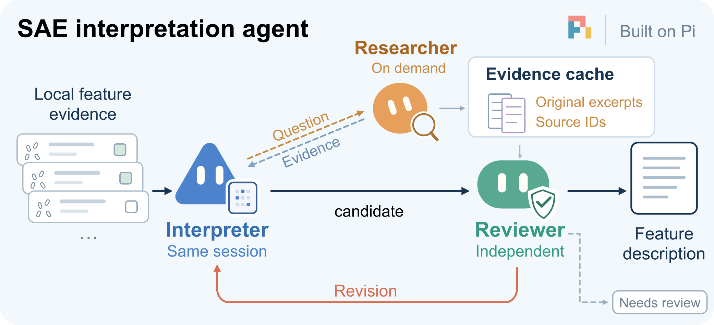
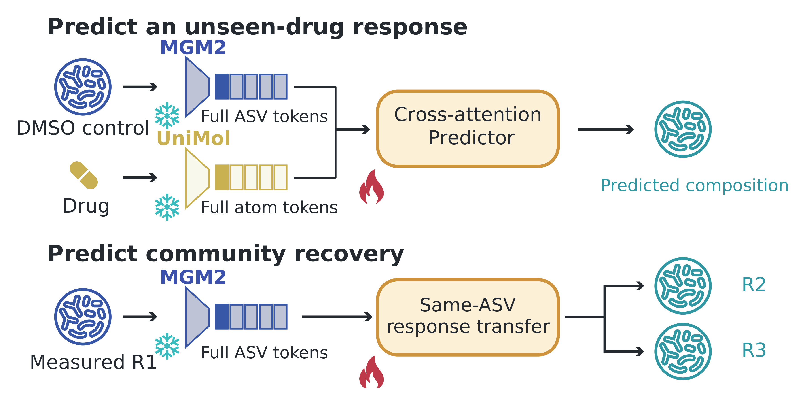

<h1 align="center">MGM2 as a Multimodal Foundation Model for Microbial Community States and Responses</h1>

<p align="center">
  <a href="#requirements"></a>
  <a href="#requirements"></a>
  <a href="https://huggingface.co/LudensZhang/MGM2"></a>
  <a href="https://doi.org/10.64898/2026.07.20.739063"></a>
</p>

<p align="center">
  <a href="https://doi.org/10.64898/2026.07.20.739063">Preprint</a> ·
  <a href="docs/MODEL.md">Model guide</a> ·
  <a href="notebooks/01_getting_started.ipynb">Getting-started notebook</a> ·
  <a href="https://www.mgm2atlas.com/">Feature atlas</a> ·
  <a href="https://github.com/LudensZhang/mgm2-sae-agent">Interpretation agent</a>
</p>

Microbial General Model 2 (MGM2) is a multimodal foundation model for microbial
communities. It integrates microbial sequence identity, quantitative abundance and community descriptions
to learn representations at both the community and organism level. Pretrained
on a corpus of 1.82 million microbiomes, MGM2 provides a shared representation
for studying community states, predicting responses to intervention and
interpreting microbial features in their ecological context.

**MGM2 v2.0** trains community representations through CLS-conditioned abundance
reconstruction and semantic alignment. See the [v2.0 release notes](docs/releases/v2.0.0.md).

The model family spans four encoder scales, from 4M to 33M parameters, and
represents each community with up to 768 microbial tokens. This repository
provides community embedding, contextual OTU representations and sparse
autoencoder inference, together with model configurations and article benchmark
tables.

<p align="center">
  
</p>

## Contents

- [Setup](#setup)
- [Interactive tutorial](#interactive-tutorial)
- [Usage](#usage)
  - [Checkpoints](#checkpoints)
  - [Community and OTU representations](#community-and-otu-representations)
  - [Embedding an abundance table](#embedding-an-abundance-table)
- [Sparse features and interpretation](#sparse-features-and-interpretation)
- [Data and pretraining](#data-and-pretraining)
- [Benchmarks](#benchmarks)
- [Citation](#citation)

## Setup

### Requirements

MGM2 uses Python 3.10 or later and PyTorch 2.2 or later. The core package depends
on NumPy, h5py and safetensors; the abundance-table interface also uses pandas.
The examples below run on CPU. Device placement is explicit through the
`device` argument and the CLI's `--device` option.

### Installation

Clone the repository, create an isolated environment and install MGM2:

```bash
git clone https://github.com/HUST-NingKang-Lab/MGM2.git
cd MGM2
python3 -m venv .venv
source .venv/bin/activate
python -m pip install --upgrade pip
python -m pip install '.[tables,hub]'
python -m pip check
mgm2-embed --version
```

For development and tests:

```bash
python -m pip install -e '.[tables,dev]'
python -m pytest -q
```

Download the matching model bundle, containing `models/`, `embeddings/` and
`sae/`, and set `MODEL_ROOT`:

```bash
python -c 'from huggingface_hub import snapshot_download; snapshot_download(repo_id="LudensZhang/MGM2", revision="v2.0.0", local_dir="../MGM2-models")'
export MODEL_ROOT="$(cd ../MGM2-models && pwd)"
```

The runtime package lives in `src/mgm2`; model weights and embedding banks
are separate Hugging Face resources. See [Installation](docs/INSTALLATION.md)
for GPU setup, optional dependencies and resource paths, and
[Development](docs/DEVELOPMENT.md) for repository structure and build checks.

## Interactive tutorial

The [getting-started notebook](notebooks/01_getting_started.ipynb) walks through
community preprocessing, Small embeddings, contextual OTU states, a CSV/CLI
round trip and the matched XLarge sparse autoencoder. It includes compact plots
and exports embeddings with sample and OTU identifiers.

```bash
python -m pip install '.[notebook]'
python -m ipykernel install --user --name mgm2 --display-name "Python (MGM2)"
python -m jupyterlab notebooks/01_getting_started.ipynb
```

Select the **Python (MGM2)** kernel. The tutorial uses constructed community
abundances over real OTU vocabulary entries and runs on CPU by default.

## Usage

### Checkpoints

All pretrained checkpoints and embedding resources are available on
[Hugging Face](https://huggingface.co/LudensZhang/MGM2/tree/v2.0.0).
The links below point to the versioned MGM2 v2.0 release.

Each scale pairs a community encoder with CLS-based abundance reconstruction
and semantic projection heads. Checkpoints use `safetensors`, with architecture
and source-checkpoint identity recorded in `config.json`.

| Model | Encoder parameters | Hidden dimension | Layers | Model directory |
|---|---:|---:|---:|---|
| MGM2-Small | 4,076,352 | 224 | 6 | [models/small](https://huggingface.co/LudensZhang/MGM2/tree/v2.0.0/models/small) |
| MGM2-Medium | 8,096,640 | 320 | 6 | [models/medium](https://huggingface.co/LudensZhang/MGM2/tree/v2.0.0/models/medium) |
| MGM2-Large | 15,083,520 | 384 | 8 | [models/large](https://huggingface.co/LudensZhang/MGM2/tree/v2.0.0/models/large) |
| MGM2-XLarge | 32,838,656 | 512 | 10 | [models/xlarge](https://huggingface.co/LudensZhang/MGM2/tree/v2.0.0/models/xlarge) |

Parameter counts refer to the community encoder. Each checkpoint is selected
by its full pretraining validation loss. See the [model guide](docs/MODEL.md)
for architecture details and [migration guide](docs/MIGRATION.md) for the
loading interface across model generations.

### Community and OTU representations

The following example constructs a community from three OTUs in the embedding
bank and returns its community-level and contextual token representations.

```python
import os
from pathlib import Path

import torch
from mgm2 import MGM2, EmbeddingBank, prepare_sample, collate_samples

root = Path(os.environ.get("MODEL_ROOT", "../huggingface"))
model = MGM2.from_pretrained(root / "models/small", device="cpu")

with EmbeddingBank(root / "embeddings/otus_99_embeddings.h5") as bank:
    sample = prepare_sample(bank.ids[:3], [20, 5, 1], bank)

batch = collate_samples([sample], device="cpu")
with torch.inference_mode():
    outputs = model(batch)

print(outputs["cls"].shape)     # (1, 224): community representation
print(outputs["hidden"].shape)  # (1, 4, 224): CLS followed by three OTUs
```

The loader enters evaluation mode. A forward pass exposes four complementary
representations:

| Output | Representation |
|---|---|
| `cls` | One learned representation per community |
| `hidden` | Contextual states for CLS and individual OTUs |
| `mean_pool` | Mean of valid OTU states, excluding CLS and padding |
| `qwen` | L2-normalized community projection into the 4,096-dimensional semantic space |

### Embedding an abundance table

The command-line interface reads a feature-by-sample CSV. Its first column
contains OTU identifiers; the remaining columns contain sample counts or
relative abundances.

```bash
mgm2-embed \
  --model "$MODEL_ROOT/models/small" \
  --table communities.csv \
  --embeddings "$MODEL_ROOT/embeddings/otus_99_embeddings.h5" \
  --output outputs/communities.npz \
  --device cpu --batch-size 16
```

For taxonomic feature names, add
`--fallback "$MODEL_ROOT/embeddings/otus_99_taxonomy_fallback.h5"`.
The resolver records direct sequence matches, taxonomic matches and global
fallbacks for every sample. For ASV identifiers, supply an HDF5 bank containing
the corresponding NTv3 sequence embeddings.

The output archive contains `sample_ids`, `cls`, `mean_pool`, `qwen`,
feature-resolution counts, model scale and source-checkpoint SHA256.
Load it with `numpy.load(path, allow_pickle=False)`.

## Sparse features and interpretation

### Sparse autoencoder

The SAE maps MGM2-XLarge layer-10 OTU states into a dictionary of 4,096 sparse
features. BatchTopK training uses an average activation budget of 64, while
inference applies a calibrated fixed threshold. The dictionary includes a
stored affine normalizer and its corresponding decoder.

Using the community batch constructed above:

```python
from mgm2 import load_sae

backbone = MGM2.from_pretrained(root / "models/xlarge", device="cpu")
sae = load_sae(root / "sae/otu_l10_k64", device="cpu")

with torch.inference_mode():
    states = backbone(batch)["hidden"]
    valid = (batch["input_ids"] >= 0) & batch["attention_mask"].bool()
    features = sae.encode(states[valid])
    reconstructed_states = sae.denormalize(sae.decode(features))

print(features.shape)  # (3, 4096): one sparse feature vector per OTU
```

### Interpretation agent

The [interpretation agent](https://github.com/LudensZhang/mgm2-sae-agent) connects
sparse features to local quantitative evidence and retrieved literature. An
interpreter develops feature descriptions, a researcher retrieves evidence on
demand, and an independent reviewer evaluates the resulting claims. A shared
evidence cache preserves reusable excerpts and source identifiers; structured
views and compact handoffs reduce repeated context transfer between roles.

<p align="center">
  
</p>

## Data and pretraining

The pretraining corpus contains 1,821,291 microbiome communities, partitioned
into 1,639,420 training communities and 181,871 project-disjoint validation
communities. The model bundle includes NTv3-derived embeddings for 225,066 OTUs
and taxonomic fallback embeddings for 5,087 groups.

Each community is normalized to relative abundance before selecting up to 768
observed OTUs. Positive abundances below 1e-4 are raised to 1e-4, then transformed
with `clip(log10(x) + 2, -2, 2)`. The retained values preserve this scale after
selection and flooring. Per-community quantiles define five positive-abundance
bins, indexed 0–4.

Pretraining combines masked-abundance classification, high-abundance regression
and semantic alignment to Qwen3-Embedding-8B. The reconstruction decoder uses
the community CLS state together with each queried OTU's static identity.
The trained encoder produces both community-level and contextual OTU
representations at inference. [Model details](docs/MODEL.md) describe masking,
binning and objectives; the scale configurations are in `configs/`.

## Benchmarks

The article evaluates MGM2 across three predictive settings and sparse-feature
interpretation:

| Application | Evaluation | Source tables |
|---|---|---|
| MGnify | Hierarchical biome classification across five levels | `benchmarks/mgnify/` |
| FMT | Post-transplant community, clinical response and recovery modelling | `benchmarks/fmt/` |
| Drug perturbation | Drug-conditioned community changes and recovery | `benchmarks/drug/` |
| SAE | Sparse reconstruction and evidence-based feature interpretation | `benchmarks/sae/` |

<p align="center">
  
</p>

The [benchmark guide](benchmarks/README.md) describes the aggregate article
tables, evaluation units and cohort definitions.

## Citation

The MGM2 preprint is available on bioRxiv:

Zhang, H. et al. [MGM2 as a Multimodal Foundation Model for Microbial Community States and Responses](https://doi.org/10.64898/2026.07.20.739063). *bioRxiv* (2026).

```bibtex
@article{zhang2026mgm2,
  title   = {{MGM2} as a Multimodal Foundation Model for Microbial Community States and Responses},
  author  = {Zhang, Haohong and Zhang, Yuli and Qi, Yuxuan and Liu, Tianao and Zhao, Linfeng and Yang, Ronghua and Ning, Kang},
  journal = {bioRxiv},
  year    = {2026},
  doi     = {10.64898/2026.07.20.739063},
  url     = {https://doi.org/10.64898/2026.07.20.739063}
}
```
