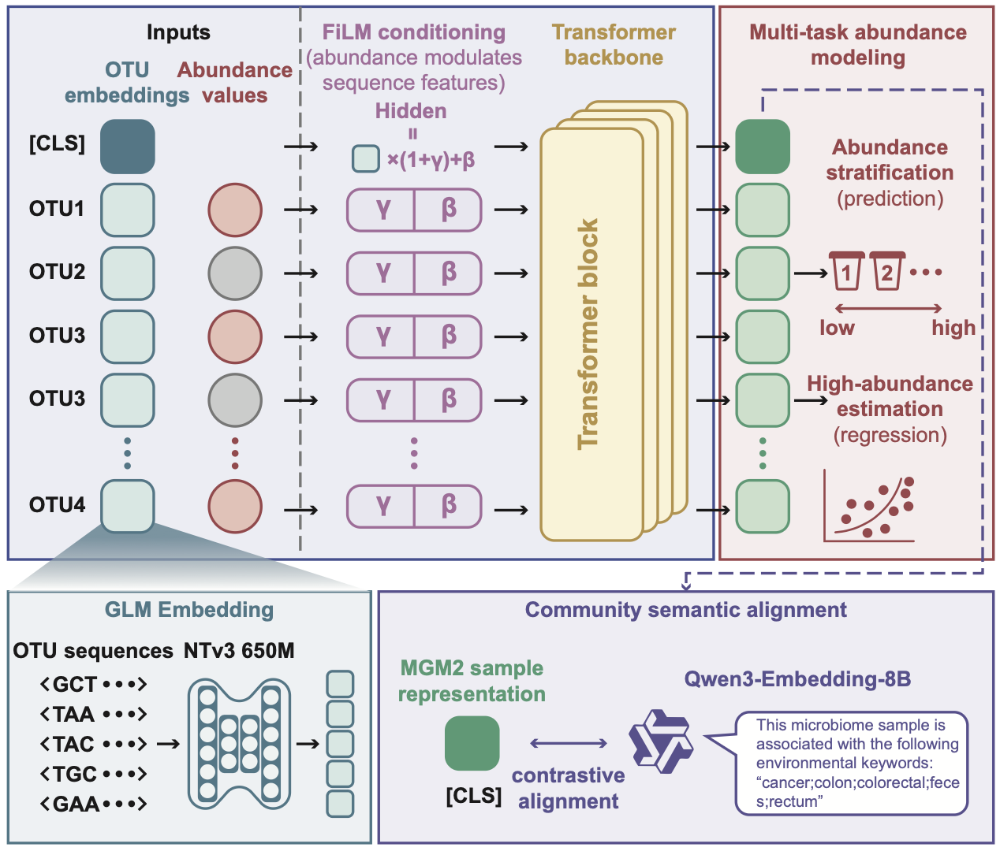

# MGM2: A Foundation Model for Microbial Communities

MGM2 is a Transformer-based foundation model for learning representations of microbial communities from taxon abundance profiles. Each community is represented as a set of microbial features initialized with NTv3 embeddings and paired with their relative abundances. MGM2 pretraining masks the abundance channel while preserving microbial identity, encouraging the model to learn ecological context and abundance structure across communities.



The repository contains the MGM2 model, data preprocessing and pretraining code, scale-specific configurations, downstream task workflows, and representation analysis utilities.

## Model overview

MGM2 combines pretrained microbial feature embeddings with abundance-aware Transformer encoding. A learnable community-level `[CLS]` token provides a sample representation for downstream prediction, while contextualized microbial tokens support feature-level tasks.

Pretraining uses two complementary masked objectives:

1. **Masked abundance-bin classification** predicts a discretized abundance category for masked microbial features. Quantile binning can be performed independently within each sample, allowing the objective to model community-relative abundance structure.
2. **Masked log-abundance regression** reconstructs continuous transformed abundance values. Regression supervision can be restricted to the highest abundance bins through `regression_top_k_bins`.

Only the abundance signal is corrupted during masking; microbial feature identity remains available to the model. The combined objective is controlled by `loss.lambda_bin` and `loss.lambda_regression` in the JSON configuration.

MGM2 also supports **optional sample-level Qwen3 alignment**. When enabled, the community `[CLS]` representation is projected into the space of sample metadata embeddings and trained with a contrastive alignment objective. Samples without a corresponding metadata embedding remain available to the abundance objectives and are excluded only from the alignment loss.

## Model scales

The standard MGM2 family provides four model sizes with a shared input representation and training objective:

| Scale | Hidden size | Transformer layers | Attention heads | Feed-forward size |
| --- | ---: | ---: | ---: | ---: |
| Small | 224 | 6 | 4 | 896 |
| Medium | 320 | 6 | 5 | 1,280 |
| Large | 384 | 8 | 6 | 1,536 |
| XLarge | 512 | 10 | 8 | 2,048 |

Scale presets are defined in [`scripts/grid_search_pretrain_stage2.sh`](scripts/grid_search_pretrain_stage2.sh). Custom architectures can be created by changing the `model` section of an MGM2 JSON configuration.

## Repository layout

```text
MGM2/
├── src/
│   ├── configs/              # Typed configuration and default JSON config
│   ├── data/                 # Dataset builders, preprocessing, and loaders
│   ├── losses/               # Pretraining and downstream objectives
│   ├── metrics/              # Shared evaluation metrics
│   ├── models/               # MGM2 backbone and task-specific models
│   ├── sae_interpretation/   # Sparse feature interpretation components
│   └── training/             # Pretraining and downstream entry points
├── scripts/
│   ├── downstreams/          # Reproducible downstream workflows
│   ├── regular_analysis/     # Embedding and fallback analyses
│   ├── sae/                  # Sparse autoencoder workflows
│   └── sae_interpretation/   # Feature interpretation pipeline
├── tests/                    # Unit and regression tests
├── pipeline.png              # Model and analysis pipeline
└── README.md
```

## Installation

MGM2 is developed in Python with PyTorch and PyTorch Lightning. Dataset preparation additionally uses NumPy, pandas, SciPy, h5py, tqdm, and `biom-format` when BIOM input is required. Create an isolated environment and install versions compatible with the CUDA and PyTorch installation on the target system.

Run commands from the repository root so that the local `src` package is available.

## Build a pretraining dataset

The dataset builder accepts CSV, TSV, HDF5, and BIOM community tables. It stores nonzero relative abundances and feature indices in a serialized dataset; abundance transformation and masking are applied by the training data pipeline.

```bash
python src/data/build_dataset.py \
  --otu_table data/otu_table.csv \
  --format csv \
  --ntv3_embedding ntv3_embeddings/otus_99_embeddings.h5 \
  --top_k_otus 768 \
  --output data/pretrain_dataset.pkl
```

Set `--top_k_otus 0` to retain all nonzero features. For community tables whose feature identifiers are not directly represented in the NTv3 vocabulary, a taxonomy-derived fallback embedding file can be supplied:

```bash
python src/data/build_dataset.py \
  --otu_table data/otu_table.tsv \
  --format tsv \
  --ntv3_embedding ntv3_embeddings/otus_99_embeddings.h5 \
  --fallback_embedding ntv3_embeddings/taxonomy_fallback.h5 \
  --resolved_embedding data/resolved_embeddings.h5 \
  --top_k_otus 768 \
  --output data/pretrain_dataset.pkl
```

Fallback embedding files can be generated with [`scripts/build_taxonomy_ntv3_fallback.py`](scripts/build_taxonomy_ntv3_fallback.py). Validate prepared resources before training with [`scripts/validate_dataset.py`](scripts/validate_dataset.py) and [`scripts/validate_ntv3_embedding.py`](scripts/validate_ntv3_embedding.py).

## Pretraining

The default configuration is [`src/configs/mgm2_default.json`](src/configs/mgm2_default.json). A standard pretraining run is launched with:

```bash
python src/training/Pretrain.py \
  --data_file data/pretrain_dataset.pkl \
  --ntv3_embedding_path ntv3_embeddings/otus_99_embeddings.h5 \
  --config src/configs/mgm2_default.json \
  --output_dir outputs_mgm2/pretrain \
  --experiment_name mgm2_pretrain \
  --devices 0
```

To enable sample-level metadata alignment, provide precomputed Qwen3 embeddings keyed by sample identifier:

```bash
python src/training/Pretrain.py \
  --data_file data/pretrain_dataset.pkl \
  --ntv3_embedding_path ntv3_embeddings/otus_99_embeddings.h5 \
  --config src/configs/mgm2_default.json \
  --enable_qwen3_alignment \
  --qwen3_embedding_path qwen3_embeddings/sample_metadata.h5 \
  --output_dir outputs_mgm2/pretrain_qwen3 \
  --experiment_name mgm2_pretrain_qwen3 \
  --devices 0
```

Sample-level Qwen3 targets can be prepared with [`qwen3_keywords_embedding.py`](qwen3_keywords_embedding.py). The alignment objective is disabled by default and can be configured through the `qwen3_alignment` section.

### Resume from a checkpoint

Each run saves periodic checkpoints and `last.ckpt` under its output directory. Resume the complete optimizer and training state with `--resume`:

```bash
python src/training/Pretrain.py \
  --data_file data/pretrain_dataset.pkl \
  --ntv3_embedding_path ntv3_embeddings/otus_99_embeddings.h5 \
  --config outputs_mgm2/pretrain/config.json \
  --output_dir outputs_mgm2/pretrain \
  --experiment_name mgm2_pretrain \
  --devices 0 \
  --resume outputs_mgm2/pretrain/checkpoints/last.ckpt
```

Use the same dataset, embedding resources, and model configuration when resuming a run.

## Downstream tasks

MGM2 representations can be used as frozen features or fine-tuned with task-specific heads. The repository includes workflows for:

- [Microbial community classification on MGnify](scripts/downstreams/MGnify_mst/)
- [FMT community and response prediction](scripts/downstreams/FMT/)
- [FMT analysis on the Cell Reports cohort](scripts/downstreams/FMT_cellreports/)
- [Drug perturbation response prediction](scripts/downstreams/drug_perturbation/)
- [Wastewater temporal forecasting](scripts/downstreams/wastewater/)
- [Token-level wastewater forecasting](scripts/downstreams/wastewater_v2/)
- [Global wastewater abundance forecasting](scripts/downstreams/wastewater_global_forecast/)

Sparse autoencoder training and feature interpretation workflows are available under [`scripts/sae/`](scripts/sae/) and [`scripts/sae_interpretation/`](scripts/sae_interpretation/).

Each downstream directory contains the data preparation, training, evaluation, or plotting entry points used for that task. Paths to datasets, embeddings, checkpoints, output directories, and accelerator devices should be adapted to the local environment before launching shell workflows.

## Data and pretrained checkpoints

Large datasets, embedding matrices, and pretrained checkpoints are distributed separately from the source code through project releases and resources associated with the publication. Users may also build compatible datasets from their own community tables using the provided preprocessing pipeline.

## Reproducibility and testing

MGM2 experiments are configured through JSON files and command-line arguments. Training writes the resolved configuration, checkpoints, TensorBoard logs, and CSV logs to the selected output directory. For reproducible experiments, retain the generated configuration together with the dataset version, embedding version, checkpoint, split definition, and random seed.

Run the test suite from the repository root:

```bash
python -m pytest -q
```

For a lightweight pretraining integration check, add `--fast_dev_run` to the pretraining command. Dataset and embedding validation scripts can be run independently before allocating accelerator resources.

## Citation

If you use MGM2 in your research, please cite the accompanying paper; complete citation metadata will accompany the publication.
