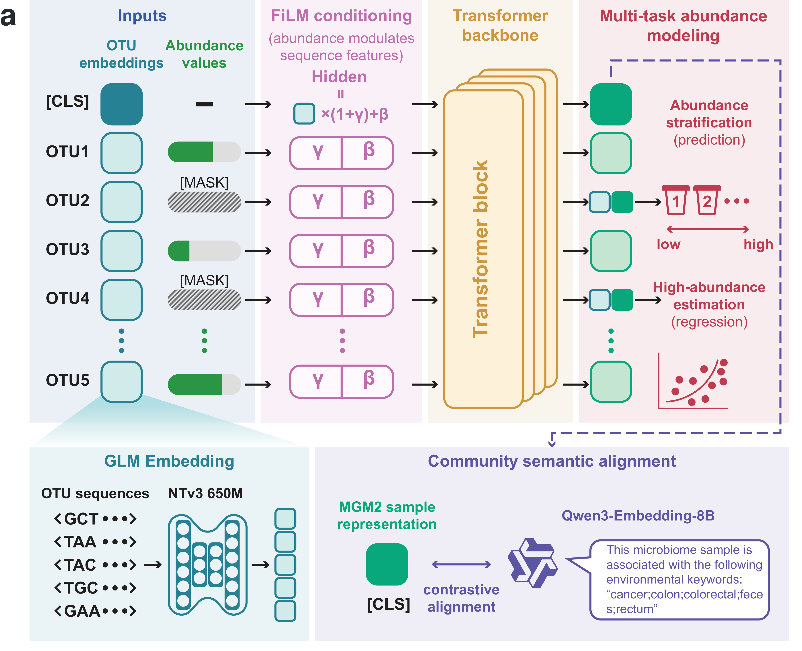

# Microbial General Model 2 (MGM2)

[](https://pypi.org/project/microformer-mgm2/)
[](https://pepy.tech/project/microformer-mgm2)
[](https://huggingface.co/LudensZhang/MGM2)

MGM2 is a multimodal foundation model for microbial community states and
responses. Pretrained on 1.82 million microbiomes, it integrates sequence
identity, abundance and community descriptions to produce community-level
embeddings and contextual microbial representations.



## Installation

Python 3.10 or later is required. Install the package and table-inference tools:

```bash
python -m pip install 'microformer-mgm2[tables,hub]'
mgm2-embed --help
```

The distribution is `microformer-mgm2`; the Python import is `mgm2`.
For GPU use, install the appropriate [PyTorch build](https://pytorch.org/get-started/locally/).

## Model resources

Four pretrained encoders, sequence and taxonomy embedding banks, and the
XLarge sparse autoencoder are available on
[Hugging Face](https://huggingface.co/LudensZhang/MGM2/tree/v2.1.0).

```python
from huggingface_hub import snapshot_download

snapshot_download("LudensZhang/MGM2", revision="v2.1.0", local_dir="MGM2-models")
```

## Community embeddings

Provide a feature-by-sample CSV with OTU IDs in the first column:

```bash
mgm2-embed --model MGM2-models/models/small \
  --table communities.csv \
  --embeddings MGM2-models/embeddings/otus_99_embeddings.h5 \
  --output outputs/communities.npz --device cpu
```

For taxonomic names, add
`--fallback MGM2-models/embeddings/otus_99_taxonomy_fallback.h5`.

## Your own sequences

Encode representative FASTA sequences using legacy
[NTv3_650M_pre](https://huggingface.co/InstaDeepAI/NTv3_650M_pre):

```bash
python -m pip install 'microformer-mgm2[ntv3]'
mgm2-encode-fasta --fasta representative_sequences.fasta \
  --output outputs/asv_ntv3.h5 --device cuda:0 --trust-remote-code
```

Use the generated bank with `mgm2-embed --embeddings outputs/asv_ntv3.h5`.
See the [sequence guide](https://github.com/HUST-NingKang-Lab/MGM2/blob/v2.1.0/docs/SEQUENCES.md)
for model access and local checkpoints.

## Resources

- [Code and documentation](https://github.com/HUST-NingKang-Lab/MGM2)
- [Getting-started notebook](https://github.com/HUST-NingKang-Lab/MGM2/blob/v2.1.0/notebooks/01_getting_started.ipynb)
- [Sequence notebook](https://github.com/HUST-NingKang-Lab/MGM2/blob/v2.1.0/notebooks/02_sequence_encoding.ipynb)
- [Feature atlas](https://www.mgm2atlas.com/)
- [SAE interpretation agent](https://github.com/LudensZhang/mgm2-sae-agent)
- [Preprint](https://doi.org/10.64898/2026.07.20.739063)

## License

MGM2 code uses the [MIT License](https://github.com/HUST-NingKang-Lab/MGM2/blob/main/LICENSE).
Model weights and third-party resources retain their respective terms.
